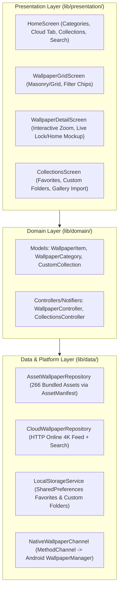

# HD Background Wallpaper App — Phase 3 & Phase 4 Design Specification

**Date:** 2026-10-12  
**Repository:** `https://github.com/Alqaasimee-jr2/HD_Background_Wallpaper_App.git`  
**Workspace:** `C:\Users\DELL\.gemini\antigravity\scratch\HD_Background_Wallpaper_App`

---

## 1. Executive Summary & Goals

This specification defines the sequential evolution of **HD_Background_Wallpaper_App** across two implementation stages following the completed Phase 1 (Clone & Explore) and Phase 2 (Codebase Audit):

1. **Phase 3 (Java/Android Overhaul & Feature Expansion):**
   - Fix all 8 critical runtime crashes, copy-paste errors, layout inflation defects, and severe `OutOfMemoryError` (`Bitmap`) memory leaks in the existing Java codebase.
   - Unlock all **266 bundled HD/4K wallpaper assets** (`~45 MB` in `app/src/main/assets`) using dynamic asset discovery and smart categorization.
   - Add core and power-user features: Search & Filter, Favorites & Custom Collections/Folders, Import Custom Wallpaper from Device Gallery, Online Cloud Wallpapers feed, Live Preview Mockup Mode (Lock Screen & Home Screen overlays), Set Wallpaper Target Picker (Home / Lock / Both), Save to Gallery, and Share.
   - Commit the completed Phase 3 Java overhaul to git so the repository history preserves the fixed, enhanced native Java version.

2. **Phase 4 (Full Flutter In-Place Migration):**
   - Replace the Java application **in-place** inside `HD_Background_Wallpaper_App` with a modern, cross-platform **Flutter** architecture (`UI -> Domain -> Data`).
   - Preserve all 266 bundled wallpaper assets and implement the full suite of offline + online cloud wallpapers, custom collections, gallery import, interactive full-screen preview with Live Lock/Home Screen mockup overlays, and native Android `MethodChannel` wallpaper application (`HOME_SCREEN`, `LOCK_SCREEN`, `BOTH`).

---

## 2. Phase 3: Java/Android Overhaul & Feature Architecture

### 2.1 Bug Fixes & Memory Management (`AsyncThumbnailLoader` + `WallpaperCatalog`)
- **Crash & Data Fixes:**
  - Fix `game22.jpeg` -> `game22.jpg` (`FileNotFoundException` crash when opening Game Wallpapers).
  - Fix `gameList21`..`gameList29` copy-paste bug where `gameList20` was added 10 times.
  - Fix `waterfall anime.jpg.jpg` -> `waterfall anime.jpg` (`FileNotFoundException` crash in Anime Wallpapers).
  - Fix `ds.jpeg` -> `ds2.jpeg` filename mismatch on Anime item #24.
  - Fix `RecyclerView` item XML heights (`match_parent` -> `wrap_content`) and `LayoutInflater.inflate(layout, parent, false)`.
  - Unify status bar / header bar styling across `SplashScreen`, `MainActivity`, `Wallpapers`, and `WallpaperView`.
- **Dynamic Asset Catalog (`WallpaperCatalog.java`):**
  - Scans `AssetManager.list("")` at runtime to discover all **266 image files** (`.jpg`, `.jpeg`, `.png`, `.jfif`).
  - Automatically classifies every asset into **All Wallpapers (266)**, **Nature**, **Anime**, **Abstract Art**, **Black & Dark**, **Game Wallpapers**, and **Random & Misc**, ensuring zero unused assets.
- **Subsampled Async Image Engine (`ImageLoader.java`):**
  - Replaces raw `Bitmap` fields in model classes (`CategoriesList`, `WallpapersList`) with lightweight URI/asset descriptors.
  - Uses an in-memory `LruCache<String, Bitmap>` (sized to 1/8th of max JVM heap) and a background `ExecutorService` to decode downsampled thumbnails (`BitmapFactory.Options.inSampleSize`) and close all `InputStream`s via `try-with-resources`.

### 2.2 New Features in Phase 3
1. **Search & Category Filtering:**
   - Real-time search bar in `MainActivity` and `Wallpapers` activity to filter wallpapers by title, tag, or category.
2. **Favorites & Custom Collections (`CollectionsManager.java`):**
   - Persisted via `SharedPreferences` (JSON/Set storage).
   - Users can heart/bookmark any wallpaper into **Favorites** or create custom named **Collections / Folders** (e.g., "AMOLED Setup", "Anime Favorites").
3. **Import Custom Wallpaper from Device Gallery:**
   - Floating Action Button / Action bar button using Android's `ActivityResultContracts.GetContent()` (`image/*`) to import images from the user's device, persist their URI permissions, add them to custom collections, preview them with overlays, and set them as wallpaper.
4. **Online Cloud Wallpapers Integration (`CloudWallpaperService.java`):**
   - Dedicated **Cloud / Online Explore** tab/category alongside offline categories.
   - Fetches curated high-resolution mobile wallpapers over HTTPS (`HttpURLConnection` on background executor with disk/memory caching and no API key required via curated public JSON/Picsum/Wikimedia/Unsplash feeds, plus optional API key support).
5. **Interactive `WallpaperView` with Live Preview Mockup Mode:**
   - **Live Lock Screen Mockup Overlay:** Toggleable overlay displaying a realistic large digital clock (`22:18`), date, notification pills, and bottom lock-screen shortcuts over the wallpaper.
   - **Live Home Screen Mockup Overlay:** Toggleable overlay displaying a realistic home screen search bar, app icon grid, and bottom dock over the wallpaper.
   - **Set Wallpaper Target Dialog:** `AlertDialog` / BottomSheet allowing the user to apply the wallpaper to **Home Screen**, **Lock Screen**, or **Both** using `WallpaperManager.FLAG_SYSTEM` and `WallpaperManager.FLAG_LOCK` on a background thread.
   - **Save to Gallery & Share:** Saves any asset/cloud wallpaper to `Pictures/HDWallpapers` via `MediaStore` and shares via Android `FileProvider` / `Intent.ACTION_SEND`.

---

## 3. Phase 4: Full Flutter In-Place Migration Architecture

Once Phase 3 is verified and committed to git, the repository will be migrated **in-place** inside `C:\Users\DELL\.gemini\antigravity\scratch\HD_Background_Wallpaper_App` to a clean, layered Flutter application.

### 3.1 Layered Architecture

### 3.2 Key Flutter Components & Platform Channel
1. **Asset Preservation (`assets/wallpapers/`):**
   - All 266 wallpapers moved cleanly into `assets/wallpapers/` and registered in `pubspec.yaml`.
   - Dynamic discovery via Flutter's `AssetManifest.loadFromAssetBundle(rootBundle)` so every single bundled image is automatically indexed and categorized.
2. **Native Android Wallpaper & Gallery Bridge (`MainActivity.kt` / `MainActivity.java`):**
   - Custom Flutter `MethodChannel('com.example.hd_background_wallpaper/wallpaper')` handled natively in the Android host activity:
     - `setWallpaper(bytes, target)` -> Uses `WallpaperManager.getInstance(context).setBitmap(...)` with `FLAG_SYSTEM`, `FLAG_LOCK`, or both.
     - `saveToGallery(bytes, fileName)` -> Saves directly to `MediaStore.Images.Media` (`Pictures/HDWallpapers`).
3. **Feature Parity & Modern Material 3 UI:**
   - **4 Main Navigation Destinations**:
     1. **Explore (Offline 266 Wallpapers + Categories + Search)**
     2. **Cloud 4K (Online Wallpapers Feed + Topic Search)**
     3. **Collections (Favorites + User-Created Custom Folders + Import from Device Gallery via `image_picker`)**
     4. **Studio / Settings (Quick Shuffle, Cache Management, App Info)**
   - **Live Preview Mockup Mode in `WallpaperDetailScreen`**:
     - Cycle between **Clean View** (pinch-to-zoom `InteractiveViewer`), **Lock Screen Mockup** (clock, date, notifications, bottom shortcuts), and **Home Screen Mockup** (status bar, widgets, app icons dock).

---

## 4. Verification & Testing Strategy

- **Phase 3 Verification:**
  - Verify all 266 assets are indexed and zero missing asset filenames remain.
  - Compile and run static/lint checks on the Java implementation.
  - Commit Phase 3 to git branch `master` (or tag `v1.1-java-enhanced`) before beginning Phase 4.
- **Phase 4 Verification:**
  - Run `flutter pub get` and `dart analyze` (must pass with zero errors/warnings).
  - Write unit and widget tests in `test/` verifying asset categorization, search filtering, custom collections management, and UI rendering (`flutter test`).
